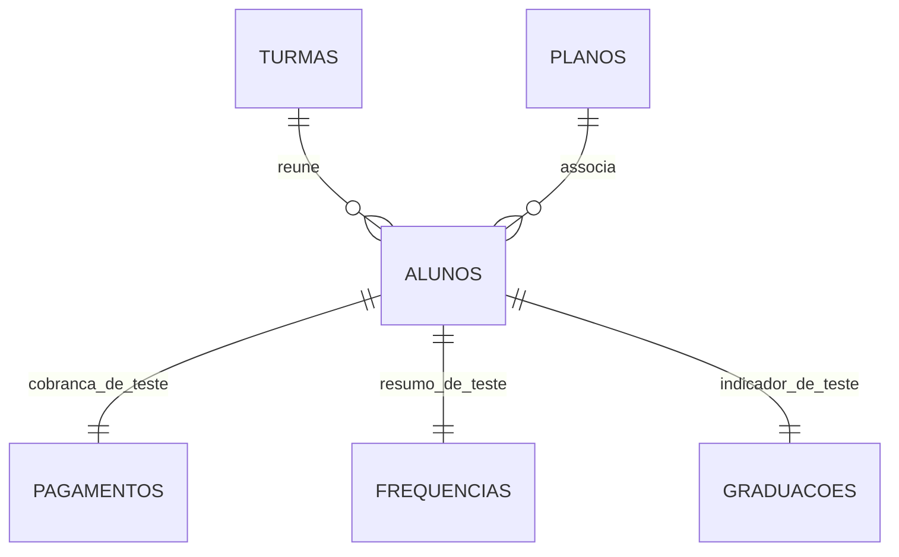

# Modelagem dos dados

O projeto inicial prevê um sistema para cadastrar alunos, controlar mensalidades e acompanhar graduações. Nesta entrega, as informações foram organizadas em arquivos CSV a partir de uma base fictícia. **Ainda não existe um banco de dados relacional implantado.**

## Estrutura gerada pelo algoritmo

| Arquivo | Identificação | Conteúdo |
|---|---|---|
| `alunos_final.csv` | `id_aluno` | Nome, modalidade, faixa, turma e plano |
| `turmas_final.csv` | `id_turma` | Modalidade e código da turma |
| `planos_final.csv` | `id_plano` | Valor da mensalidade |
| `pagamentos_final.csv` | `id_pagamento` | Vencimento, pagamento, situação, atraso e multa estimada |
| `frequencias_final.csv` | `id_aluno` | Total de aulas, presenças e frequência |
| `graduacoes_final.csv` | `id_aluno` | Faixa atual e indicação de frequência suficiente para avaliação |

Os IDs de turma e plano são gerados no processamento. O agrupamento de planos foi feito pelo valor da mensalidade, pois a base não possui o nome e as condições contratuais de cada plano. Há apenas **uma cobrança e um resumo de frequência por aluno** na simulação.

## Regras aplicadas

- **Pago:** há uma data de pagamento válida registrada.
- **Em aberto:** não há pagamento e o vencimento é igual ou posterior à data de referência.
- **Atrasado:** não há pagamento e o vencimento é anterior à data de referência.
- **Multa:** 2% sobre cobranças atrasadas e não pagas, somente para demonstração.
- **Frequência:** presenças divididas pela quantidade de aulas, em percentual.
- **Graduação:** atingiu 75% no teste, podendo ser avaliado pelo professor; sem mudança automática de faixa.
- **Baixa manual:** a função recebe o aluno e a data confirmada, altera uma cópia do pagamento e registra a confirmação. Não salva um pagamento real.

A data usada nas classificações é **02/11/2026**.

## Estrutura prevista para o sistema completo

| Tabela | Informações ainda necessárias |
|---|---|
| Alunos | Data de matrícula, situação do aluno e contato autorizado |
| Responsáveis | Dados de contato e vínculo com alunos menores |
| Turmas | Professor, horários e capacidade |
| Planos | Nome, valor, periodicidade e vencimento |
| Pagamentos | Histórico mensal, forma de pagamento e responsável pela baixa |
| Frequência | Data de cada aula e presença individual |
| Graduações | Faixa anterior, faixa atual, data da troca e avaliação do professor |

Esses dados foram previstos no levantamento, mas **não estão disponíveis no CSV de teste**. O desenvolvimento de um sistema real ainda exige definição das regras com o proprietário, armazenamento seguro, controle de acesso e cuidados com a LGPD.
